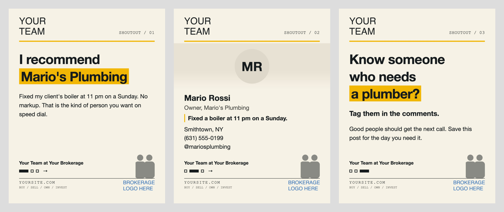

# Realtor Shoutout Carousel

A three slide Instagram carousel for recommending a local business, and a renderer that refuses to pass a slide until it is clean.

Built by Team Muds at OverSouth Real Estate on Long Island. We meet good people through this work: plumbers, contractors, cleaners, photographers. When someone does great work for a client, or comes to us through a solid referral, we say so out loud. This is the tool we use to do it.



## The three slides

1. **Why.** "I recommend" plus the business name, and one real reason in your own words.
2. **Who.** Their face or logo, name, role, the reason again in one line, town, phone, handle. Instagram sometimes shows a carousel again starting at slide 2 to people who scrolled past, so slide 2 has to make sense on its own.
3. **Do.** One ask. Tag a friend who needs them.

## The checks (every render, no exceptions)

The script measures the rendered slides and exits with an error when any check fails. Nothing should be posted from a failed run.

1. **Overlap.** Every element is compared against every other element on the slide, headline and logos included. Zero overlaps.
2. **Vertical math.** Every content block is listed top to bottom, with a positive gap between each one, and the content has to end at least 40px above the signature.
3. **Safe areas.** Everything sits inside the side margins. Nothing sits under the slide counter Instagram draws in the top right corner, or under the tag icon in the bottom left. The cover survives the profile grid crop, which trims about 34px off each side.
4. **Cohesion.** The header and footer sit in exactly the same place on every slide.
5. **Type floor and word limits.** Content text never goes under 40px. A headline has 8 words or fewer, and a body has 30 or fewer. Every slide needs alt text. When text does not fit, split the slide. Never shrink the text.
6. **Tidy.** A highlight never splits across lines, and no paragraph ends on one lonely word.
7. **Worst content.** Each spec is rendered a second time with a longer name, a longer handle and a fuller body, and every check above runs again.

You still look at every slide yourself before posting. A script cannot tell you whether the cover stops the scroll.

## Use it

```bash
pip install playwright pillow
playwright install chromium
python3 render.py example/carousel.json --out example/out
```

Output: `slide-01.jpg` to `slide-03.jpg` at 1080 by 1350, `contact-sheet.png`, `cover-grid.png` (the cover as the profile grid shows it), and `manifest.json` (alt text, byte sizes, the vertical math, any problems).

Swap in your own logos, team photo, colors and words in the spec. Use your own real reason. Never invent a review or a result.

## Music

The Instagram API cannot put music on a carousel. In Meta's own reference, `audio_name` is "For Reels only", and a carousel container has no audio field. Instagram's head, Adam Mosseri, has said a photo or carousel post with music can be shown in the Reels tab. So add the song yourself in the Instagram app, or post the slides as a Reel instead.

## A note for agents

If you recommend lenders, title companies or attorneys, a free shoutout is fine. Trading referrals with them for anything of value is not: that is RESPA Section 8, the federal rule on referral payments for home loan and closing services. Ask your broker.

## Credits

Ideas borrowed with thanks from [instagram-carousel-skill](https://github.com/social-media-skills/instagram-carousel-skill) (the slide 2 second chance, the Instagram overlay corners, the grid crop, the type floor, the contact sheet and manifest), [carousel-generator-skill](https://github.com/nopefallacy/carousel-generator-skill) (the screenshot test, and one action on the last slide), and [open-carrusel](https://github.com/Hainrixz/open-carrusel). No code was copied.

MIT license. Team Muds, OverSouth Real Estate, [hellomuds.com](https://hellomuds.com).
